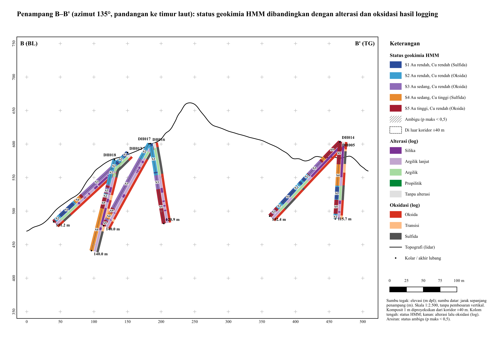

# Ramba Joring · Exploration and Environmental Analysis

For OlympiAR 2026 Round 2, our team uses surface samples, drilling and acid tests to decide where to explore next and how to handle potentially acid-forming rock at Ramba Joring in the Martabe district, North Sumatra.

**[Bilingual findings handbook](outputs/laporan_final/laporan_final_v1.html)** · **[Panduan Bahasa Indonesia](PANDUAN_TIM.md)**

## Start here

1. On GitHub, choose **Code → Download ZIP** and extract the whole folder, or clone the repository.
2. Inside the extracted folder, go to `outputs` → `laporan_final` and open `laporan_final_v1.html` in your browser. You can read it offline without installing software.
3. Choose **Bahasa Indonesia** or **English**, then select your chapter. Follow the filenames under the figures and tables to their originals. Keep the extracted folders together so those links work.

## From a finding to its evidence

In **Chapter 5 · Drilling**, two holes start on the same pad. At 10–11 m, both record S5, the gold-rich chemical unit. At 50–51 m, RJDH005 records S3 and RJDH014 records S4, the copper-rich unit. How far does that agreement extend?

Read the [paired-hole ioGAS strip log](outputs/figures/iogas/s3_strip_hmm_kembar_005_014_v1.png) from the collars down. Then use section B–B′ to see where the two holes lie in space. Equal distances down different holes can put samples at different elevations and locations.

[](outputs/maps/11_penampang_B_v1.png)

*Section B–B′. Follow the numbered chemical-unit strip along a hole, then compare the adjacent alteration and oxidation strips at the same position. Hatching marks uncertain unit assignments. Select the image for full resolution.*

To check the example, open the [one-metre composite table](data/processed/iogas/RJ_DH_komposit_1m.csv). Filter `HoleID` to RJDH005 and RJDH014, select `From` values of 10 and 50 m, and read `ML_hmm_nama` for the unit assigned to each interval.

## Find what you need

| I want to… | Open this |
| --- | --- |
| Write a report chapter | [Findings handbook](outputs/laporan_final/laporan_final_v1.html) for the evidence, interpretation limits and suggested wording. |
| Use an ioGAS figure | [Figure index and caption notes](outputs/figures/iogas/indeks_gambar_iogas.csv) to choose a plot, then [original PNGs](outputs/figures/iogas/) for the full-resolution export. |
| Reopen an ioGAS project | [Project guide](outputs/iogas_project/BACA_SAYA.txt) to choose the soil, rock, drill-composite or environmental project. |
| Find a map or section | [QGIS projects and map exports](outputs/maps/) for sections A–C and the proposed drill design. |
| Check a reported number | [Sample results](data/processed/geochem_analysis.csv) and their [column dictionary](data/processed/geochem_analysis_kolom.csv). For chapter summaries, use the handbook’s evidence index. |
| Assemble the submission | [Submission folder](outputs/kirim/) and [file manifest](outputs/kirim/MANIFEST.csv) to match the packaged files to their sources. |

## Team handoff

The submission folder contains the **validation CSVs**, **ioGAS project archive**, and **geochemistry tables**. The team still needs to add the [report PDF](outputs/kirim/4_laporan/) and [presentation PDF](outputs/kirim/5_presentasi/). The [team checklist](PANDUAN_TIM.md#6-pekerjaan-terbuka-untuk-manusia) covers the regional map, drainage checks and reference verification.

Committee material is confidential. Process it locally, preserve the raw data, and give revised figures or tables a new version once an earlier version has been cited.

<details>
<summary><strong>Reproduce the analysis</strong></summary>

From the repository root, use `uv` with Python 3.11 or 3.12. These commands install the locked dependencies, check the raw data, run the tests, and rebuild the handbook from existing results.

```sh
uv sync --locked
uv run python scripts/00_inventory.py
uv run pytest -q
uv run python scripts/29_laporan_final.py
```

For a specific analysis, use the [numbered scripts](scripts/) and consult the [decision log](LOG.md) for inputs, processing order and validation results. Open a saved `.qgz` project in QGIS. If a layer needs reconnecting, locate its matching file in the [GIS folder](gis/). On the team’s licensed ioGAS machine, choose **File → Open** and select a [final project](outputs/iogas_project/) ending in `_final_v1.gas`.

</details>
